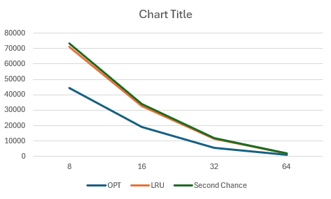

# Part 1
---------------------------------------
| Algorithm  | Frames | Page Faults |
|-------|-----|------------|
| OPT | 8  | 44394   |
| OPT    | 16  | 19311   |
| OPT  | 32  | 5779 |
| OPT | 64  | 907   |
| LRU    | 8  | 71064   |
| LRU  | 16  | 32761 |
| LRU | 32  | 11426   |
| LRU    | 64  | 1880   |
| Second Chance  | 8  | 73291 |
| Second Chance | 16  | 33816   |
| Second Chance    | 32  | 12037   |
| Second Chance  | 64  | 2034 |
---------------------------------------
Above is a chart of collected data from the 3 algorithms and their fault counts. Below is am image of graph made in excel graphing these points.

While ideally I would like to use OPT in my operating system such an option is not viable as most computers cannot see the future. In the case of GCC.trace which this graph was made from, LRU is the clear winner. Second chance while good is just slightly less efficient than LRU. There are cases where second chance is a better option, however in my opinion and from the results I have seen I would prefer to use LRU in one of my own systems.
# Part 2
Included in my repo is a file called "SecondRangeTests.txt" which is where my data I will be referencing is. I added a second second chance method called secondR() which took in a file name and ran the test on all frame numbers from 2 to the input number of frames.
---------------------------------------
There are multiple instance of Belady's anomaly here, as well as an interesting quirk with one of the traces specifically. Frames 39-40 of swim.trace exhibit the anamoly, as well as frames 54,55-56,57 in the same trace. It appears often, and that is to be expected. What I find interesting are the results of gzip.trace, as I am not sure if it is an issue with my own code or a quirk of second chance. Beggining at 22 frames the number of page faults flatlines, never decreasing further, rather inreasing on frames 30 and 31 before returning to the plateau of 39,874 page faults. Whether this is an odd bug I managed to create, or an actual effect of secnd chance I find it just as interesting.
# Part 3
My initial implementation of OPT was naive, and took ages to run. I optimized this by adding an extra data structure to track the next appearance of all values. This switch caused many strange bugs and issues but overall drastically improved performance, however it only bounded the progress to the number of frames and number of lines in the trace file. This means that while the test cases on gradescope with only 2 frames run fairly quickly, there is a spike in runtime as the number of frames increases. If frames and lines were equal I am fairly sure my runtime would be somewhere around O(N^2).